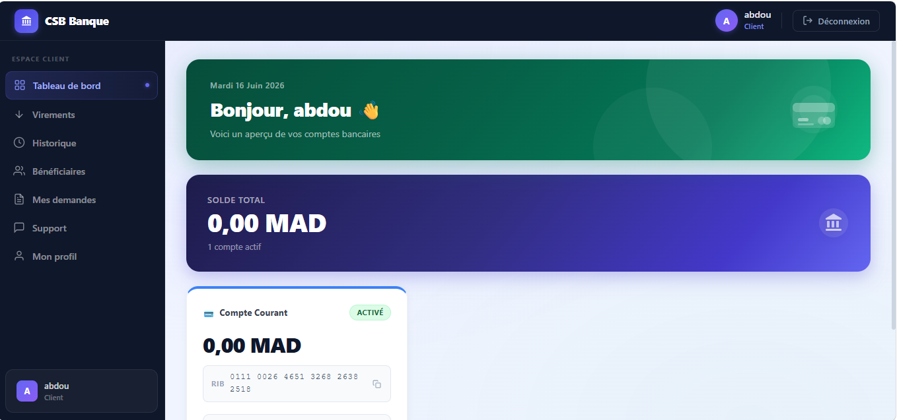
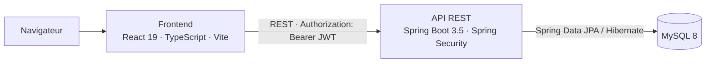
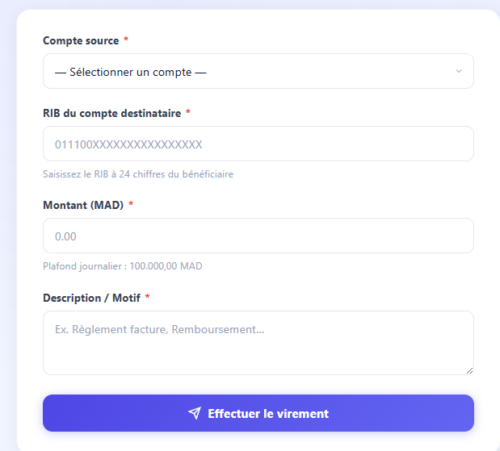
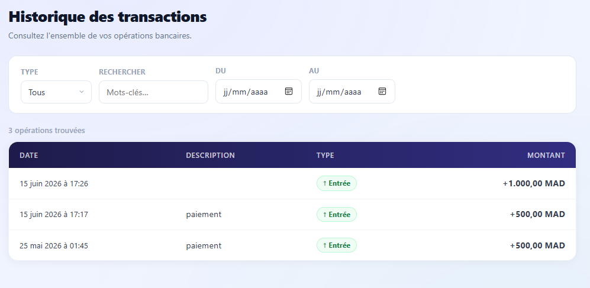
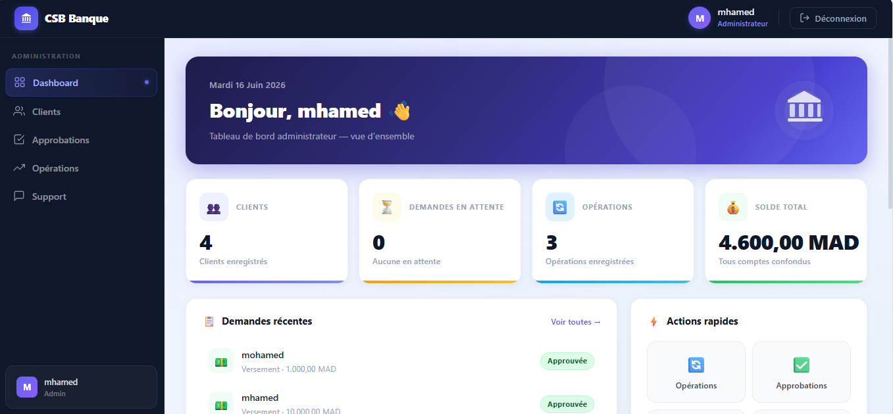
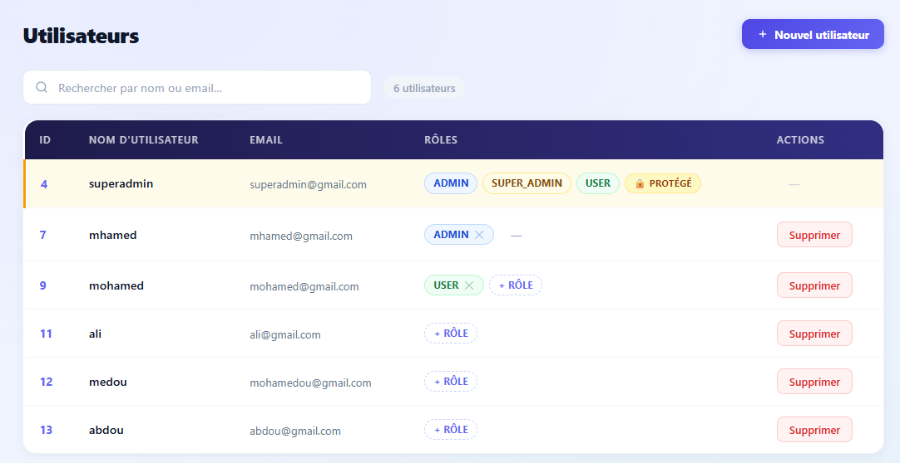
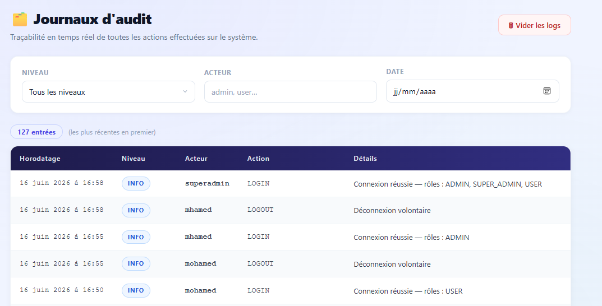
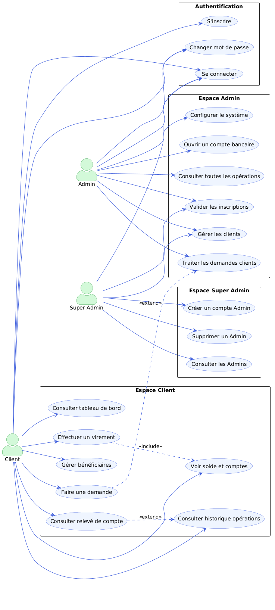
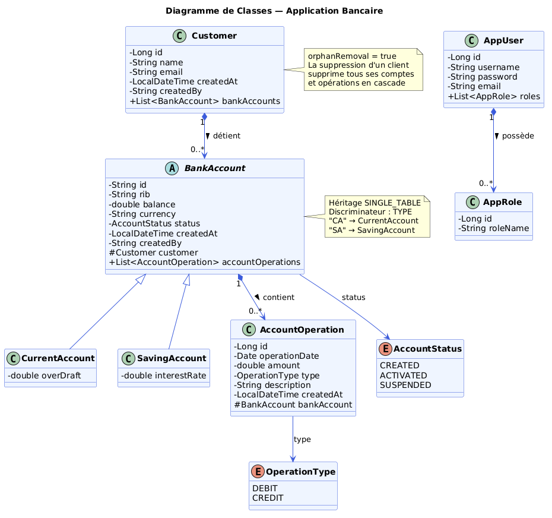
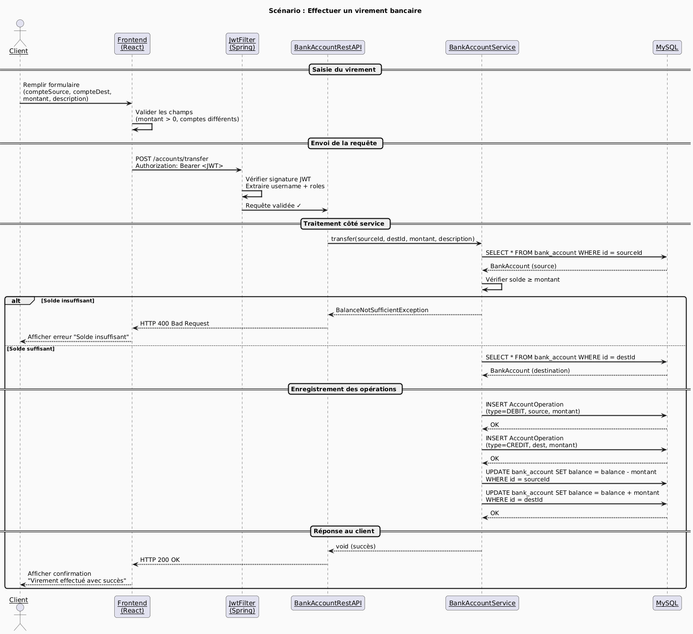

# CSB Banque — Plateforme de gestion bancaire digitale

Application web full-stack de gestion bancaire, avec trois espaces selon le rôle (client, administrateur, super administrateur), une authentification par jeton JWT et une API REST sécurisée.

Projet de Fin d'Année (PFA) — 4ème année, EMSI, 2025-2026.



## Fonctionnalités

**Client**
- Tableau de bord : solde total, comptes, notifications sur les demandes
- Virement par RIB, avec vérification du compte destinataire en temps réel, plafond journalier et frais
- Historique des transactions filtrable (type, mots-clés, période)
- Gestion des bénéficiaires, demandes en ligne (relevé, versement), relevé de compte imprimable
- Support par tickets, profil et changement de mot de passe

**Administrateur**
- Tableau de bord avec indicateurs (clients, opérations, solde total)
- Gestion des clients (recherche, suppression, détection des doublons) et ouverture de compte courant
- Détail d'un compte avec historique paginé et opérations de débit, crédit et virement
- Validation des demandes de versement et des inscriptions, vue globale des opérations

**Super administrateur**
- Gestion des utilisateurs et de leurs rôles
- Journal d'audit des actions sensibles (connexions, virements, validations)
- Configuration du système : plafonds, frais de virement, découvert, montants minimum et maximum

## Architecture



- Le frontend est une SPA qui ne communique avec le serveur que par HTTP. Une instance Axios centralisée ajoute le jeton JWT à chaque requête et déconnecte l'utilisateur si l'API répond 401.
- Le backend suit une architecture en couches : contrôleurs REST, services métier, repositories JPA.
- Les mots de passe sont hachés avec BCrypt ; les jetons JWT sont signés en HS256.
- Les accès sont contrôlés par rôle (`USER`, `ADMIN`, `SUPER_ADMIN`) côté API (`@PreAuthorize`) comme côté interface (routes protégées).

## Stack technique

| Couche | Technologies |
|---|---|
| Frontend | React 19, TypeScript, Vite, React Router 7, Axios, Context API + `useReducer`, CSS Modules |
| Backend | Java 17, Spring Boot 3.5, Spring Security (OAuth2 Resource Server, JWT), Spring Data JPA / Hibernate, Springdoc OpenAPI |
| Base de données | MySQL 8 |

## Captures d'écran

| Connexion | Virement |
|---|---|
|  |  |

| Historique des transactions | Tableau de bord administrateur |
|---|---|
|  |  |

| Utilisateurs et rôles | Journal d'audit |
|---|---|
|  |  |

## Conception UML

| Cas d'utilisation | Diagramme de classes | Séquence : virement |
|---|---|---|
|  |  |  |

## Structure du projet

```
.
├── backend/digital-banking/   API REST Spring Boot
│   └── src/main/java/com/banque/digital_banking/
│       ├── entities/          Customer, BankAccount (Current/Saving), AccountOperation
│       ├── services/          logique métier
│       ├── web/               contrôleurs REST
│       └── security/          Spring Security, JWT, utilisateurs et rôles
├── frontend/                  SPA React
│   └── src/
│       ├── api/               appels HTTP (instance Axios + intercepteurs)
│       ├── context/           authentification (Context + Reducer), notifications
│       ├── hooks/             hooks personnalisés
│       ├── components/        composants réutilisables
│       └── pages/             écrans par rôle
└── docs/                      captures d'écran et diagrammes UML
```

## Installation et lancement

**Prérequis :** Java 17+, MySQL 8, Node.js 18+ (Maven n'est pas nécessaire grâce au wrapper `mvnw`).

1. **Base de données** — démarrez MySQL. La base `banque` est créée automatiquement au premier lancement. Si vos identifiants MySQL diffèrent de `root`, renseignez-les dans `backend/digital-banking/.env` :
   ```env
   MYSQL_USER=votre_utilisateur
   MYSQL_PASSWORD=votre_mot_de_passe
   ```
2. **Backend** (port `8086`) :
   ```bash
   cd backend/digital-banking
   ./mvnw spring-boot:run
   ```
   Sous Windows : `mvnw.cmd spring-boot:run`. La documentation de l'API est disponible sur http://localhost:8086/swagger-ui/index.html
3. **Frontend** (port `4200`) :
   ```bash
   cd frontend
   npm install
   npm run dev
   ```
4. Ouvrez http://localhost:4200

## Comptes de démonstration

Créés automatiquement sur une base vide (mot de passe : `12345`).

| Utilisateur | Rôle |
|---|---|
| `superadmin` | Super administrateur |
| `admin` | Administrateur |
| `user1`, `user2` | Client |

## Évolutions prévues

- Persistance côté serveur des demandes, tickets, bénéficiaires, journal d'audit et configuration (aujourd'hui stockés dans le navigateur)
- Tests automatisés du frontend
- Application mobile, notifications en temps réel et paiement en ligne

## Équipe

- Mohamed Mahmoud Sid Mhamed — chef de projet, développeur full-stack
- Moutia Mohamed Amine — développeur frontend
- Bouchemakhete Marouane — développeur frontend, tests
